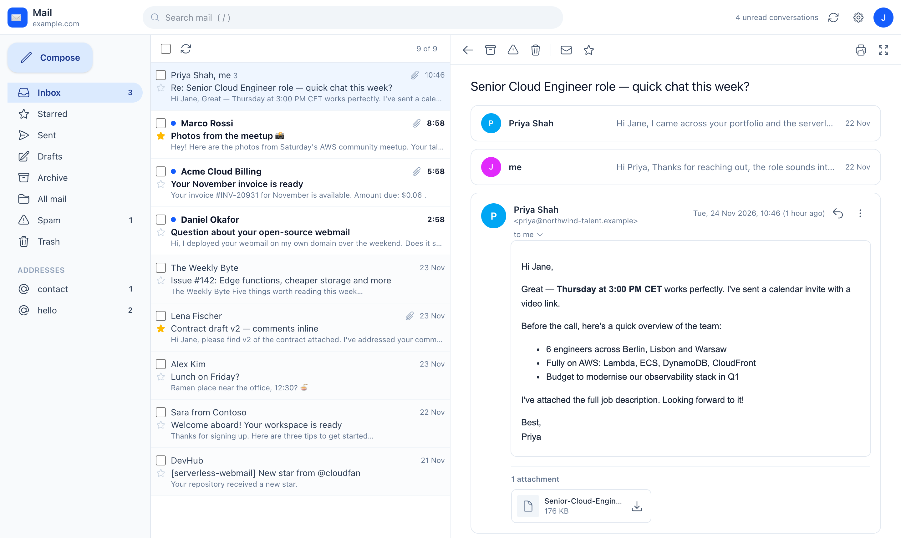
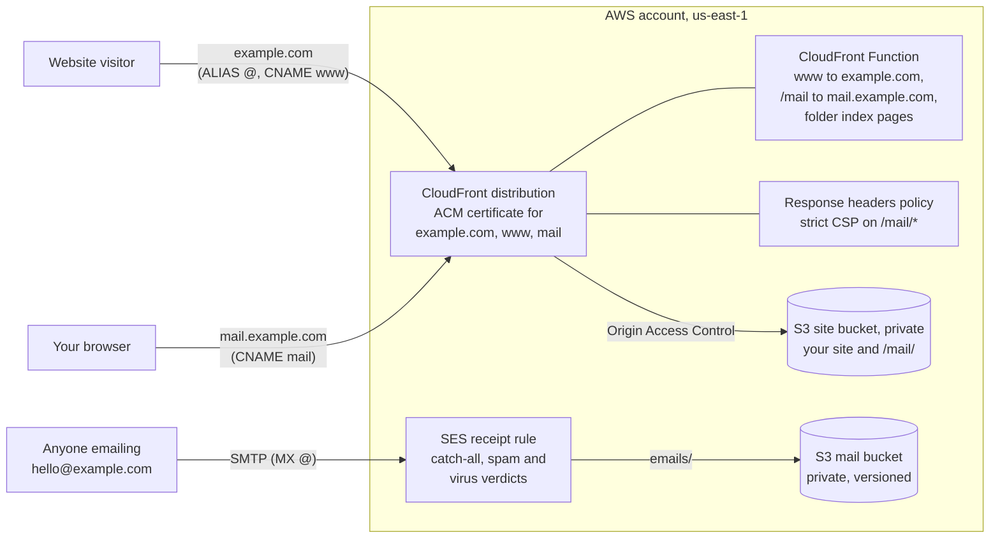
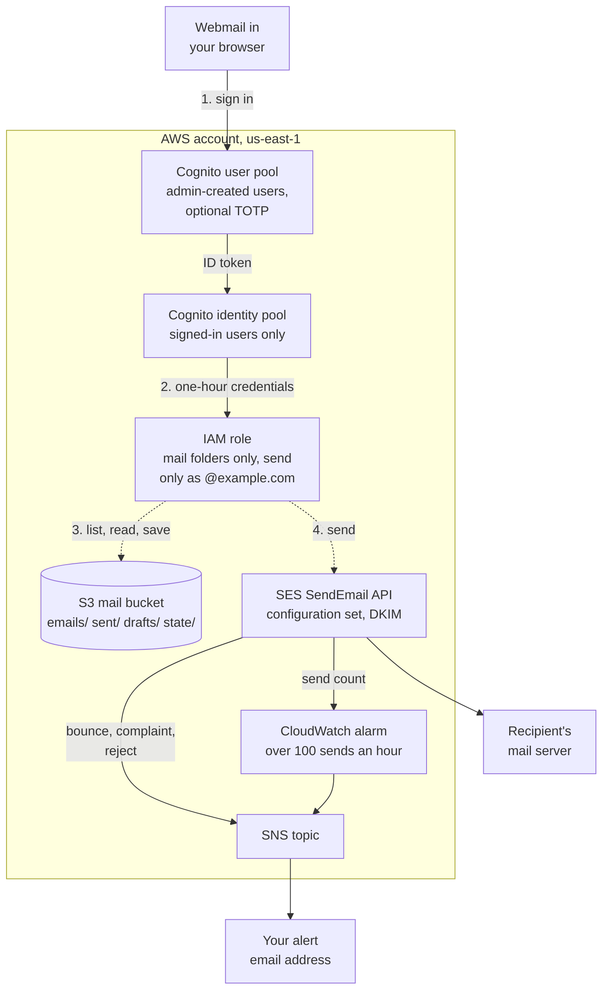

# serverless-webmail

Email at your own domain, plus a static website, on AWS for a few cents a month. There are no servers to run and no mail hosting subscription.

Mail sent to `anything@yourdomain.com` lands in your account, and you read, search, reply and send from a webmail at `https://mail.yourdomain.com/mail/`. It runs on managed AWS services (SES, S3, CloudFront and Cognito). The webmail is a static single-page app that calls AWS directly from the browser with short-lived credentials that can only reach your mailbox.

<p align="center">
  <picture>
    <source media="(prefers-color-scheme: dark)" srcset="docs/screenshot-dark.png">
    
  </picture>
</p>

| Typical cost | Servers to manage | Setup |
|:---:|:---:|:---:|
| about $0.06 a month<br><sub>1 user, about 100 page views, 50 emails in and 50 out</sub> | 0 | one command plus DNS records |

The [cost calculator](#cost-calculator) shows how each factor changes the bill.

## Features

### Mail

- Catch-all receiving: every `*@yourdomain.com` address works without setup, and each address gets its own entry in the sidebar.
- Compose, reply, reply all and forward in floating windows (up to 3, with minimise and full screen).
- A From address picker, To/Cc/Bcc fields with contact autocomplete, a rich-text editor and a signature.
- Attachments up to 20 MB from the file picker or by drag and drop, inline images, and non-ASCII file names (RFC 2231/2047).
- Undo send (0 to 30 seconds), and drafts saved every 2.5 seconds.
- Conversation threading by Message-ID, In-Reply-To and References.
- Inbox, Starred, Sent, Drafts, Archive, All mail, Spam and Trash. Trash empties itself after 30 days.
- Search with `from:` `to:` `subject:` `has:attachment` `is:unread`.
- Bulk select, and undo for archive and delete.
- Read, star and archive state synced across devices. Each flag merges separately, so two devices don't overwrite each other.

### Reading untrusted mail

- HTML email renders in a sandboxed iframe with no scripts, after DOMPurify sanitises it.
- Remote images stay blocked until you choose "Show images" or "Always show from this sender", which also stops tracking pixels.
- SES adds free spam and virus verdicts, and the webmail uses them to fill the Spam folder.
- Image preview, `.eml` download, "Show original" and print.

### Account and interface

- Cognito sign-in with optional TOTP two-step verification (any authenticator app), password change, and sign-out on all devices.
- Dark, light and system themes, keyboard shortcuts (press `?` for the list) and desktop notifications.
- On a phone it shows one pane at a time.

### Operations

- One CloudFormation template and one deploy script that is safe to rerun.
- Deleted or overwritten mail can be recovered for 30 days (S3 versioning).
- Email alerts for bounces, complaints and rejects, and an alarm when more than 100 emails are sent in an hour.

## Architecture

How web traffic and incoming mail reach your account:



What the webmail does once it's loaded:



The browser loads the webmail from CloudFront like any other page. After sign-in, the Cognito identity pool exchanges the user pool's ID token for temporary AWS credentials of one IAM role. Those credentials can list and read `emails/`, `sent/`, `drafts/` and `state/` in the mail bucket, write `sent/`, `drafts/` and `state/`, and call SES only with a From address at your domain through this stack's configuration set. Messages are parsed in the browser with postal-mime, and outgoing mail is built in the browser by `webmail/mime.js` and sent with the SES v2 API, which supports CORS. There is no Lambda, API Gateway, EC2 instance or database.

`deploy.sh` requests the ACM certificate, activates the receipt rule set and creates the first user. Everything else in the diagram is in `template.yaml`.

### Repository layout

| Path | What it is |
|---|---|
| `template.yaml` | CloudFormation: site bucket and CloudFront, mail bucket, SES identity, receipt rule and configuration set, SNS alerts and alarm, Cognito, IAM role |
| `deploy.sh` | Deploy script, safe to rerun: certificate, stack, rule set activation, first user, upload, cache invalidation, DNS record list |
| `docs/` | Screenshots, the interactive [cost calculator](docs/cost-calculator.html) and a website-only template |
| `site/` | Placeholder website. Replace it, or point `SITE_DIR` at your own folder |
| `webmail/index.html`, `app.js`, `mime.js`, `theme.js` | The webmail, with no build step |
| `webmail/vendor/` | Pinned, locally bundled libraries (AWS SDK v3, postal-mime, DOMPurify, qrcode, Tailwind browser build). Rebuild with `vendor/build.sh`; versions are in `VERSIONS.txt` |

## Cost calculator

Prices are us-east-1 list prices at the time of writing, so check the AWS pricing pages for your case. The always-free tiers are applied: CloudFront 1 TB, 10 million requests and 2 million function calls a month, Cognito Lite 10,000 monthly active users, 1,000 SNS emails and 10 CloudWatch alarms.

[`docs/cost-calculator.html`](docs/cost-calculator.html) is an interactive version with sliders and presets. It's a single file that works offline in any browser, and it uses the same formulas as the tables below.

### What each factor costs

| Change | Monthly cost | Why |
|---|---|---|
| Receive 1,000 more emails (real or spam) | +$0.20 | SES charges $0.10 per 1,000 emails plus $0.09 per 1,000 incoming 256 KB chunks, and S3 stores the state changes |
| Send 1,000 more emails | +$0.22 | SES $0.10, plus about 21 S3 writes per email from draft autosave and the sent copy |
| Attach 1 GB more in sent mail | +$0.12 | SES attachment data |
| Keep the webmail tab open 1 more hour a day | +$0.0045 | One S3 list request every 2 minutes while the tab is visible (900 a month) |
| Store 1 GB more mail | +$0.023 | S3 Standard storage. Deleted mail is kept for 30 days |
| Get 10,000 more page views | $0 | Inside CloudFront's free tier up to about 1 TB or 10 million requests a month |
| Add more logins | $0 | Cognito Lite is free up to 10,000 monthly active users. Each open tab adds its own refresh requests |

### Example scenarios

| Scenario | Assumptions | SES | S3 | Other | Total a month |
|---|---|---|---|---|---|
| Light personal use | 50 page views, 20 in and 5 out, tab open 1 h a day, 20 MB stored | $0.004 | $0.006 | $0.000 | $0.011 |
| Typical (the headline number) | 100 views, 50 in and 50 out, tab open 8 h a day, 50 MB | $0.015 | $0.044 | $0.000 | $0.059 |
| Typical, tab open 24/7 | Same, but the webmail tab never closes | $0.015 | $0.116 | $0.000 | $0.131 |
| Busy freelancer | 2,000 views, 500 in and 300 out (0.5 MB attachments on average), 10 h a day, 2 GB | $0.143 | $0.132 | $0.000 | $0.274 |
| Shared inbox, 3 people | 20,000 views, 3,000 in and 1,500 out, 3 logins open 24/7, 10 GB | $0.808 | $0.761 | $0.000 | $1.57 |
| Typical plus a spam wave | Typical, plus 10,000 spam emails to the catch-all | $1.92 | $0.052 | $0.000 | $1.97 |
| Popular website | Typical mail, 1 million views of a 1 MB site (about 954 GB, inside the 1 TB free tier) | $0.015 | $0.044 | $0.300 | $0.359 |
| Viral website | Typical mail, 3 million views of a 1 MB site (about 2.9 TB, past the free tier) | $0.015 | $0.044 | $168.28 | $168.34 |

"Other" covers CloudFront data, requests and the CloudFront Function, Cognito, SNS and CloudWatch. ACM certificates, IAM, CloudFormation and the SES configuration set are free.

For personal use the bill is a few cents, and the biggest line is the webmail's auto-refresh while the tab is open, not the email itself. Spam is the main cost risk on the mail side, because the catch-all accepts every address; if it grows, narrow the receipt rule to specific addresses. Website traffic is free up to about 1 TB a month, after which CloudFront costs about $85 per extra TB.

Since 21 July 2026, new SES accounts (no SES use since June 2025) start on the SES Essentials plan, which bills sent mail at $0.16 per 1,000 instead of $0.10. At 50 emails a month that adds about $0.003. You can switch to à la carte pricing in the SES console at any time.

The project leaves out a Route 53 hosted zone ($0.50 a month), KMS customer keys ($1 a month), WAF ($5 or more a month), access logging, SES dedicated IPs, SMS MFA and the Cognito Essentials and Plus tiers, because each would add cost.

Set an AWS Budget alert (Billing console, then Budgets) on the first day, and turn on two-step verification in the webmail. A stolen session could send mail up to your SES quota.

## Prerequisites

- An AWS account and the AWS CLI v2, configured so that `aws sts get-caller-identity` works. Deploy with an IAM user or role that has admin rights, not root access keys.
- A domain whose DNS you control. For the bare domain (`example.com`), your DNS provider needs ALIAS, ANAME or CNAME flattening, or you can use Route 53.
- `bash` and `python3`. macOS, Linux and AWS CloudShell have both, and CloudShell is the easiest place to run the script.
- No other email service on the domain. The MX record points at SES, so any existing mailboxes or forwarding for the domain stop receiving.
- Everything deploys to us-east-1, because SES receiving and CloudFront certificates both need it there. SES allows one active receipt rule set per region, and the script refuses to replace an existing one.

## Quick start

```bash
git clone https://github.com/XFarooqi/serverless-webmail.git
cd serverless-webmail
ALERT_EMAIL=you@gmail.com ./deploy.sh example.com
```

1. The first run requests the certificate for `example.com`, `www` and `mail`, and prints 3 CNAME records. Add them at your DNS provider, wait until they resolve (usually minutes), then run the same command again.
2. The second run deploys everything (a few minutes the first time, mostly CloudFront), creates the webmail user, uploads the site and prints the full list of DNS records. The list is also saved in `dns-records.txt`, which git ignores.
3. Add the remaining records: ALIAS `@` and CNAME `www` for the website, CNAME `mail` for the webmail, 3 DKIM CNAMEs, MX, and the SPF and DMARC TXT records. First delete any old A, CNAME or redirect records for `@`, `www` and `mail`, and any old MX records. If a `v=spf1` TXT record already exists, add `include:amazonses.com` to it, because a domain can have only one SPF record.
4. If you set `ALERT_EMAIL`, confirm the SNS subscription email AWS sends you. Alerts aren't delivered until you do.
5. Wait until `aws sesv2 get-email-identity --region us-east-1 --email-identity example.com --query DkimAttributes.Status` prints `SUCCESS`. Sending needs it.
6. Open `https://mail.example.com/mail/` and sign in with the username and password in `.webmail-login` (ignored by git, file mode 600). Then change the password and turn on two-step verification in Settings, under Security.

To test receiving, send an email from any account to `hello@example.com`. It reaches the bucket within seconds and appears on the webmail's next refresh.

If a deploy fails, the script prints the reason AWS gives. A failed first deploy is removed automatically on the next run, and `ALERT_EMAIL` is remembered, so you only pass it once.

To move a live site with no downtime, test CloudFront before you change DNS:

```bash
curl --resolve example.com:443:$(dig +short <distribution>.cloudfront.net | head -1) https://example.com/
```

### Configuration

| Variable | Default | Meaning |
|---|---|---|
| `ALERT_EMAIL` | none | Where bounce, complaint, reject and high-volume alerts go |
| `MAIL_USER` | `admin` | Webmail username created on the first run |
| `SITE_DIR` | `./site` | Folder published at the site root. Dotfiles and `*.md` files are skipped, and `site/404.html` is used if the folder has no `404.html` |

The stack is named `webmail-<domain-with-dashes>`.

## Sending to any address (SES production access)

New AWS accounts start in the SES sandbox. There you can send only to verified addresses, which includes your own domain, up to 200 emails a day. Receiving works either way, and the webmail tells you when a send is refused because of the sandbox.

Production access is free, and AWS usually answers within a day:

1. Publish DKIM, SPF and DMARC first (`deploy.sh` prints them) and make sure the website loads.
2. Send the request, or use the SES console (Account dashboard, then Request production access):

```bash
aws sesv2 put-account-details --region us-east-1 \
  --production-access-enabled \
  --mail-type TRANSACTIONAL \
  --website-url "https://example.com" \
  --contact-language EN \
  --use-case-description "Personal email for my domain example.com. I reply one-to-one to people who contact me, from a private webmail only I can log in to. Under 50 emails per month. No marketing, newsletters or bulk sending, no purchased lists. DKIM, SPF and DMARC are published, bounces and complaints are monitored, and addresses that bounce or complain are suppressed automatically."
```

3. Check the result: `aws sesv2 get-account --query '{Production:ProductionAccessEnabled,Review:Details.ReviewDetails}'`

Describe your real use. If AWS refuses, reply to their email with more detail. After a few weeks of clean DMARC reports (they arrive at `dmarc@yourdomain`), consider changing DMARC to `p=quarantine`.

## Security model

- There is no public sign-up. Users exist only if an admin creates them (`AllowAdminCreateUserOnly`). Passwords need 12 or more characters, and TOTP two-step verification is optional.
- The browser's credentials can only list and read `emails/`, `sent/`, `drafts/` and `state/`, write `sent/`, `drafts/` and `state/`, delete in `emails/`, `sent/` and `drafts/`, and call `ses:SendEmail` with the condition `ses:FromAddress = *@yourdomain` through this stack's configuration set. They can't touch the site bucket or anything else in the account.
- Both buckets are private, encrypted with SSE-S3 and accept TLS only. The site is reachable only through CloudFront, using Origin Access Control.
- `/mail/*` is served with a strict Content Security Policy (scripts only from the site itself, network calls only to Cognito, SES and the mail bucket), HSTS, `X-Frame-Options: DENY`, `nosniff` and `no-referrer`. All libraries are pinned and served from the repository, never from a CDN.
- Incoming mail is treated as hostile: a sandboxed iframe without scripts, DOMPurify with a CSS allow-list, remote content blocked until you allow it, `cid:` images converted to `data:` URLs, attachments always downloaded and never rendered on the site's origin, and a MIME builder that blocks header injection.
- Abuse limits: SES account-level suppression for bounces and complaints, SNS alerts, and a CloudWatch alarm above 100 sends an hour.
- The webmail is served only from `https://mail.<domain>/mail/`, and `https://<domain>/mail` redirects there. Browsers keep storage per origin, so scripts on your website (analytics, widgets, framework bundles) can't read the webmail's tokens. The mail bucket's CORS rule allows only the mail origin.
- Tokens are kept in `sessionStorage`, or in `localStorage` if you tick "Keep me signed in". Signing out revokes the refresh token and clears cached mail data.

You are still responsible for keeping your AWS credentials safe, turning on two-step verification, setting a budget alert, and giving the webmail login only to people you'd trust with the mailbox.

## Day-to-day tasks

| Task | How |
|---|---|
| Update the site or webmail | Edit the files, then rerun `./deploy.sh example.com`. The alert email from the first run is kept |
| Add a new address | Nothing to do (catch-all). An address appears in the sidebar after its first email |
| Change the password or 2FA | Webmail, Settings, Security |
| Find the pool ID and bucket names | `aws cloudformation describe-stacks --region us-east-1 --stack-name webmail-example-com --query "Stacks[0].Outputs" --output table` |
| Add a login (shares the same mailbox) | `aws cognito-idp admin-create-user --region us-east-1 --user-pool-id <pool> --username <name> --message-action SUPPRESS`, then set a password as below |
| Set or reset a password (kept out of shell history) | `read -rs -p 'New password: ' PW; echo; aws cognito-idp admin-set-user-password --region us-east-1 --user-pool-id <pool> --username admin --password "$PW" --permanent; unset PW` |
| Lost the authenticator app | `aws cognito-idp admin-set-user-mfa-preference --region us-east-1 --user-pool-id <pool> --username admin --software-token-mfa-settings Enabled=false,PreferredMfa=false` |
| Recover a deleted email (within 30 days) | `aws s3api list-object-versions --region us-east-1 --bucket <mail-bucket> --prefix emails/` to find the key and `VersionId`, then `aws s3api copy-object --region us-east-1 --bucket <mail-bucket> --key <key> --copy-source "<mail-bucket>/<key>?versionId=<id>"` |
| Rebuild the bundled libraries | `webmail/vendor/build.sh` (needs Node.js and npm) |

## Uninstall

1. Remove the DNS records, MX first, so senders get a clean failure.
2. Run `aws ses set-active-receipt-rule-set --region us-east-1` (with no name, it deactivates the rule set). Then empty the site bucket and run `aws cloudformation delete-stack --stack-name webmail-example-com --region us-east-1`.
3. The mail bucket is kept on purpose (`DeletionPolicy: Retain`) so mail is never deleted by accident. Download what you need, then empty it, old versions included, and delete it yourself.
4. Delete the ACM certificate if nothing else uses it.

## Limitations

- One shared mailbox per domain: every login sees all mail. It isn't a multi-user mail service.
- No IMAP or SMTP, so desktop and phone mail apps can't connect. The webmail is the client.
- New mail appears when the inbox refreshes (every 2 minutes while the tab is visible). There are no push notifications from the server.
- Search runs in the browser over message headers and snippets.
- SES accepts messages up to 40 MB (the webmail caps attachments at 20 MB) and receives mail only in some regions. This project uses us-east-1.
- Receiving costs grow with every email delivered to the catch-all, spam included.

## Testing

The repository has no automated test suite. Before deploying changes, at least run `cp webmail/app.js /tmp/app.mjs && node --check /tmp/app.mjs` to check it as an ES module, then try sign-in, compose and send, reply, archive, trash and restore, and search on the live site.

## License

MIT, see [LICENSE](LICENSE). The bundled third-party libraries keep their own licenses, listed in `webmail/vendor/LICENSES.txt`: AWS SDK for JavaScript (Apache-2.0), postal-mime (MIT-0), DOMPurify (Apache-2.0 or MPL-2.0), qrcode (MIT) and Tailwind CSS (MIT).
